# LangUtils

It is recommended to read [Crafting Interpreters](https://craftinginterpreters.com/) to gain a general understanding of how compilers work.
The pipeline is split into stages, each with its own data structure, as in the Rust and Zig compilers. Like them, it stores the graphs as flat arrays addressed by typed indexes. Unlike them, the parser is generated by Bison, and there is no type checker, as SuperCollider is dynamically typed.


The language utilities folder contains all the tools for inspecting, compiling, or doing any operations on the language.
If you want to inspect the language in anyway, you should use these tools to avoid duplicating and eventually drifting from the languages implementation.
SuperCollider is a moderately complex language with some unusual edge cases, so it is best to avoid rewriting wherever possible.


Each step is split into its own library so depending on your use case, you need to choose which one is most appropriate, additionally there are some pre-made tools which might meet your needs.

This compiler pipeline is a fairly standard one.
Previously, SuperCollider had these stages: 1. lexing (PyrLexer.cpp), 2. parsing & semantic analysis (the bison grammar), 3. lowering, emitting & loading (PyrParseNode.cpp).
Because these stages were all joined, sometimes information and structures have influenced previous and future stages leading to unusual and confusing language features, most oddities of the language boil down to this *'blurring'* of stages — this is the reason why the ***lowerer*** needs to know about ***frames***.


These are now split, should remain as separate as possible.

This has a performance cost though, so the compiler has been carefully designed to mitigate this. 
The benefit is that many operations that were previously hard or impossible are now easy because you can access the data in the structure best suited to your goal, and it is harder to make semantics depend on some internal data structure of the interpreter.


In general:
* If you want to create a check or do something with ***syntax***, this will involve the *ASTGraph* which is produced in  *sc_parser*.

* If you want to check or alter ***semantics***, this will go in *sc_sema* and operate on an *IRGraph*.

* If you want to make a new optimisation for existing code (like hoisting), this goes in *sc_backend* and will operate on the ***LIR***.

* If you want to change the interpreter's bytecodes, you need to look in *sc_bytecode* and alter the ***emitter***.

* If something in the interpreter changes, the *loader* could need changing.


## Quick Glossary


### Lexing/Tokenising

This turns the raw text into a linear list of tokens and source code locations.
Linear is the important word here, there is no hierarchy, no structure, just a list.
This is where we decided what a number is, what a symbol is, what a string is, what a name is.


### Parsing

Turns the flat linear tokens into a tree representing the structure of the code, stored in an *ASTGraph*.
This is the stage where *syntax* lives.

If you want to operate on what the user actually *wrote* (not what they mean), this is where you do it.

### Semantic analysis

Gives the *syntax*, which is just structured text, *semantics*, i.e. ***meaning***.

If you want to operate on what the user *meant*, the output of this is what you want.

Produces an **IRGraph**.

### Lowering

Turns the semantic meaning of the code into a form representing abstract computation, produces an **LIR** and ***Frames***.

### Emitting

Turns the lowered abstract form into real instructions for some machine.

### Loading

Loads instruction tables into the machine.

### IR

Intermediate representation, the output of a compilation stage that needs further processing.
Changes the structure of data. 
Compilers often have several of these so they are commonly seen prepended with another letter, we use ***LIR*** for lowered--intermediate--representation.
Otherwise, **IR** by itself in this project refers to the output of the ***semantic analysis***.

### Frame

A frame is what SuperCollider uses to store its variables and arguments.
This term is used in the ***lowerer*** and in the interpreter. 
In the lowerer these are abstract and used to calculate ***slots***.

### Slots

A place where a SuperCollider object/thing is stored.
Inside the ***lowerer***, this basically behaves like a pointer, in that it represents identity and storage. 
The interpreter has a different definition and use — its explanation is omitted here as it is out of scope.

### Recursive descent parsing (what we don't do)

A hand written parser, one function per grammar rule, each calling the functions for the smaller parts it contains.
It is fast, easy to follow, and can give very good errors.

The problem is that nothing checks the grammar as a whole.
Two rules can quietly accept the same text, and which one wins depends on the order the code tries them.
SuperCollider's syntax has many edge cases, so we let a tool check this for us.

### Parser generator

Rather than write a parser by hand, there are many generators out there. 
These have their own DSLs, but generally work by writing rules for how other rules combine.
Exactly what the parse will do when something is ambiguous, depends on the generator.


We use *Bison*.

This was chosen because the old compiler used it, and we could just copy and edit the existing rules.
Becuase we use LALR(1), we can have confidence that our edits.

The down side is error recovery. Steps have been taken to mitigate this, but in future, we it might be worth revisiting this.
Moving away from bison is relativly simple as the output type *ASTGraph* is mostly independant of bison. 
It has been optimised for bottom up parsing, but is a minor internal detail.


### Parser Ambiguity

This is a misnomer. 
Parsers are never ambiguous, they are just code.
There can, however, be ambiguity in how a generator turns the grammar into a parser.

### LALR(1) & bottom up parsing (what sc_parser does)

Bottom up parsing involves putting tokens on to a stack, then seeing if you can merge them together starting from the end.
This means you parse the smallest parts of the language first (bottom up), removing those tokens from the stack and replacing with a new one ('reduce/shift').

As a side effect this means you cannot perform an action when you *begin* parsing some structure, only when you have finished parsing it and know it is valid.

LA means look--ahead, LR means left--to--right, and the (1) is how far we look--ahead.

When doing bottom up parsing we need to look at some number of extra tokens to figure out with if we match a rule and can 'reduce', in bison, we look exactly 1 token ahead. 

So long as *Bison* reports **no** shift/reduce conflicts there is **no** ambiguity in the grammar.

This is harder to write, even with a generator, due to only being able to look 1 token ahead, computationally difficult to reason about **if there are side effects to creating a node**; 
but if the grammar produces no conflicts (bison warns about this), means there will be no unexpected behaviour and we can have confidence when we add new rules.


### LAC

Look--ahead--correct.

A bison mechanism for producing better error recovery. 
It doesn't use LALR parsing, is slow, but works well.

### Constant Folding
The act of computing constant values at compile time (inside of *sc_sema*) to avoid this at runtime.
For example, `const two = 1 + 1` constant folding allows the compiler to see that `1 + 1` is in fact `2`, and emit this as-if the user had written `2`.

Due to oddities in the old compiler, backwards compatibility, and extension methods, this is not as trivial as it might seem!


## Example

*This is an abrigded, but  real, output from `sc_lexer_standalone`, `sc_parser_standalone` and `sc_inspect`. Consult the readmes of each library for specifics.*

Consider this as the input.

```supercollider
try { 1.meow }
```

Lexing produces a flat list. Whitespace produce tokens too, they are removed here.

```
[ Name['try'], OpenCurly, Integer['1'], Dot, Name['meow'], CloseCurly ]
```

Parsing produces an `ASTGraph`. 

```
PrefixMessage
    NameNode: try
    ArgumentList
    BlockList
        BlockNode
            DeclareArgumentList
            BlockContentsList
                PostfixMessage
                    IntNode: 1
                    NameNode: meow
                    ArgumentList
                    BlockList
```

Semantic analysis produces an `IRGraph`.
Both blocks are now functions, and the receiver and arguments are uniform.

```
SCMessage: try
    SCFunction
        SCBody
            SCMessage: meow
                SCLiteral = 1
```

Lowering produces a list of functions, each a list of abstract instructions (`--lir`).

```
function 0
    PushFunction 1
    Send try
function 1
    PushConstant 1
    Send meow
```

Emitting produces structures specific to the SuperCollider VM, these are omitted from this document as you can't understand them without discussing the interpreter in detail.
Use `sc_inspect --bytecode` to see them.


An important point to note is how specific each stage is.
From the raw code we get more specific and detailed each step up until the `ASTGraph`, where we reach the peak.
Then we generalise, which drastically simplifies the output, at the `IRGraph` stage.
After lowering, we are as simple as can be, but we have lost type information and the output is flat and unstructured;
its correctness is not enforced by the c++ compiler, unlike the other stages.


## Libraries

Each library has its own README, with its data structures, rules, and how to add to it.

This is the main pipeline.

| Stage | Library | Starts at | Takes | Returns |
|---|---|---|---|---|
| Normalising | [sc_source](sc_source/README.md) | `normalise_source.hpp`, `text_info.hpp` | `const char*` | `NormalisedSource`, `TextInfo` |
| Lexing | [sc_lexer](sc_lexer/README.md) | `lexer.hpp`, `tokens.hpp` | `TextInfo` | tokens and locations |
| Parsing | [sc_parser](sc_parser/README.md) | `sc_parser.hpp`, `ast.hpp` | `TextInfo`, pulls tokens from the lexer as it needs them | `ASTGraph` |
| Sema | [sc_sema](sc_sema/README.md) | `compiler.hpp` (`IRCompiler`), `ir.hpp` | `ASTGraph`s, interpreted code also needs the compiled class library | `IRGraph` |
| Backend | [sc_backend](sc_backend/README.md) | `frames.hpp`, `lower.hpp`, `emit.hpp` | `IRGraph` | `EmittedGraph` |
| Finishing | [sc_compiler](sc_compiler/README.md) | `sc_compiler.hpp` | class files, or interpreted text | `CompiledGraph` |
| Loading | `lang/LangSource/ClassLibraryLoader.cpp` | `loadClassLibrary` | `CompiledGraph` | the interpreter's classes |


*sc_backend* and *sc_compiler* are dependent on the VM's structure, bytecodes, frames, method and symbol tables ...

In the future, we could pull the lowerer out of *sc_backend*, but since we only support one VM, today, it isn't worth it.
If we ever wanted to 'jit' compile the language, or a subset of it to create synth plugins on demand, this is where we'd start.


### Shared Utilities

| Library | Purpose |
|---|---|
| [sc_util](sc_util/README.md) | Strong indexes, `IndexedVector`, the typed graph. |
| [sc_diagnostic](sc_diagnostic/README.md) | Errors and warnings with source highlights. |
| [sc_bytecode](sc_bytecode/README.md) | Structure of the VM |

Tools:

| Tool | Purpose |
|---|---|
| [sc_inspect](sc_inspect/README.md) | Runs the compiler and dumps each stage. Used to compare output between revisions. |
| [sc_explorer](sc_explorer/README.md) | Browser view of the compiler's output. |
| [sc_bench_inspect](sc_bench_inspect/README.md) | Benchmarks every stage and shows the results. |
| [sc_bench_interpreted](sc_bench_interpreted/README.md) | Benchmarks compiling interpreted code. |

## Conventions

These apply to every library here.
- Any number that indexes something is a `StrongIndex` or a `TypedIndex` (see [sc_util](sc_util/README.md)). Do not use
  `size_t` or `int` for it. Graph nodes are indexed by typed indexes.
- Where a struct should stay small, add a `static_assert` on its
  `sizeof`, as [sc_backend](sc_backend/README.md) does.


## Simplified Compiler Pipeline Graph

```mermaid
---
config:
  themeVariables:
    fontSize: 16px
  flowchart:
    padding: 24
    rankSpacing: 70
    nodeSpacing: 30
    subGraphTitleMargin:
      top: 0
      bottom: 0
---
flowchart TB
    c(["`**Class Files**`"])
    src(["`**Interactive Source Code**`"])



    subgraph source_lib [" "]
        normalize("`**Normalization**
        e.g. CRLF -> LF`")
        textinfo("`**TextInfo**
        text, path and kind`")
    end

    subgraph lexer_lib [" "]
        lexer("`**Lexer**
        lexes the whole text up front`")
    end

    subgraph parser_lib [" "]
        parser("`**Parser**
        pulls tokens, recovers from errors`")
    end

    subgraph sema_lib [" "]
        classsema("`**Sema, class library**
        all classes, in parallel`")
        interpsema("`**Sema, interpreted**
        after the class library`")
    end

    subgraph backend_lib [" "]
        frames("`**Frame layout**`")
        lowerer("`**Lowerer**`")
        emitter("`**Emitter**`")
    end

    subgraph compiler_lib [" "]
        finish("`**Finish**`")
    end

    subgraph lang_dir [" "]
        loader("`**Loader**
        ClassLibraryLoader`")
    end

    c -->|"const char*"| normalize
    src -->|"const char*"| normalize
    normalize -->|"NormalisedSource"| textinfo
    textinfo -->|"TextInfo"| lexer
    lexer -->|"Token and Location"| parser
    parser -->|"Library ASTGraphs"| classsema
    classsema -.->|"Library IRGraphs"| interpsema
    parser -->|"Interactive ASTGraph"| interpsema
    classsema -->|"IRGraph per class"| frames
    interpsema -->|"IRGraph"| frames
    frames -->|"FramedGraph"| lowerer
    lowerer -->|"LoweredGraph"| emitter
    emitter -->|"EmittedGraph"| finish
    finish -->|"CompiledGraph"| loader


    linkStyle default stroke-width:3px

    classDef input fill:#607d8b33,stroke:#607d8b
    classDef source fill:#c9a40033,stroke:#c9a400
    classDef lexerc fill:#e08a0033,stroke:#e08a00
    classDef parserc fill:#d6336c33,stroke:#d6336c
    classDef semac fill:#1c7ed633,stroke:#1c7ed6
    classDef backendc fill:#2f9e4433,stroke:#2f9e44
    classDef compilerc fill:#7048e833,stroke:#7048e8
    classDef langc fill:#49505733,stroke:#495057

    class c,src input
    class normalize,textinfo source
    class lexer lexerc
    class parser parserc
    class classsema,interpsema semac
    class frames,lowerer,emitter backendc
    class finish compilerc
    class loader langc

    style source_lib fill:#c9a4001a,stroke:#c9a400
    style lexer_lib fill:#e08a001a,stroke:#e08a00
    style parser_lib fill:#d6336c1a,stroke:#d6336c
    style sema_lib fill:#1c7ed61a,stroke:#1c7ed6
    style backend_lib fill:#2f9e441a,stroke:#2f9e44
    style compiler_lib fill:#7048e81a,stroke:#7048e8
    style lang_dir fill:#4950571a,stroke:#495057
```



