# Notes on compiler tool chain

There are 7 main stages.

* Noramlising the line endings and creating meta information for the text.

* Lexing into tokens and their location

* Parsing in a graph, including error recovery, return the ***syntax***.

* Semantically analsysing the graph, returning the ***semantic meaning*** of the code.

* The backened, which figures out what the code does to the stack and to the frames.

* Finishing, which puts all the information together

* And loading, which is where this data is put into the interpreter.

## How to use

In general: 
* If you want to create a check or do something with ***syntax***, this will invole the *ASTGraph* which is produced in  *sc_parser*.

* If you want to check or alter ***semantics***, this will go in *sc_sema* and operate on an *IRGraph*.

* If you want to make a new optimisation for existing code (like hoisting), this goes in *sc_backend* and will operate on the ***LIR***.

* If you want to change the interpreters bytecodes, you need to look in *sc_bytecodes* and alter the ***emitter***.

* If something in the interpreter changes, the *loader* could need changing.


The difference between *syntax* and *semantics* can be seen in these examples.
```
a[1];
b.();
1 + 2;
```
In the *ASTGraph* (syntax), these produce different nodes — *AtMessage*, *ValueMessage* & *BinaryMessage* —, but in the *IRGraph* these are normalised into *SCMessage*.
So if you wanted to write a warning/suggestion that people use `if(a) {...} {...}`, this would go in the *ASTGraph*.
Here the correct form would be a *PrefixMessage* checking the argument list has 1 entry, and the block list has 1 or 2 entries.
All other messages whose selector was 'if' would trigger the warning.

## Simplified control flow

```mermaid
---
config:
  theme: base
  themeVariables:
    lineColor: "#495057"
    textColor: "#1a1a1a"
    edgeLabelBackground: "#ffffff"
    fontSize: 16px
  flowchart:
    padding: 24
    rankSpacing: 70
    nodeSpacing: 30
    subGraphTitleMargin:
      top: 0
      bottom: 0
---
flowchart TB
    c(["`**Class Files**`"])
    src(["`**Interactive Source Code**`"])



    subgraph source_lib [" "]
        normalize("`**Normalization**
        e.g. CRLF -> LF`")
        textinfo("`**TextInfo**
        text, path and kind`")
    end

    subgraph lexer_lib [" "]
        lexer("`**Lexer**
        lexes the whole text up front`")
    end

    subgraph parser_lib [" "]
        parser("`**Parser**
        pulls tokens, recovers from errors`")
    end

    subgraph sema_lib [" "]
        classsema("`**Sema, class library**
        all classes, in parallel`")
        interpsema("`**Sema, interpreted**
        after the class library`")
    end

    subgraph backend_lib [" "]
        frames("`**Frame layout**`")
        lowerer("`**Lowerer**`")
        emitter("`**Emitter**`")
    end

    subgraph compiler_lib [" "]
        finish("`**Finish**`")
    end

    subgraph lang_dir [" "]
        loader("`**Loader**
        ClassLibraryLoader`")
    end

    c -->|"const char*"| normalize
    src -->|"const char*"| normalize
    normalize -->|"NormalisedSource"| textinfo
    textinfo -->|"TextInfo"| lexer
    lexer -->|"Token and Location"| parser
    parser -->|"Library ASTGraphs"| classsema
    classsema -.->|"Library IRGraphs"| interpsema
    parser -->|"Interactive ASTGraph"| interpsema
    classsema -->|"IRGraph per class"| frames
    interpsema -->|"IRGraph"| frames
    frames -->|"FramedGraph"| lowerer
    lowerer -->|"LoweredGraph"| emitter
    emitter -->|"EmittedGraph"| finish
    finish -->|"CompiledGraph"| loader


    linkStyle default stroke:#495057,stroke-width:3px

    classDef input fill:#eceff1,stroke:#607d8b,color:#1a1a1a
    classDef source fill:#fff3c4,stroke:#c9a400,color:#1a1a1a
    classDef lexerc fill:#ffe0b2,stroke:#e08a00,color:#1a1a1a
    classDef parserc fill:#f8cdd9,stroke:#d6336c,color:#1a1a1a
    classDef semac fill:#d0ebff,stroke:#1c7ed6,color:#1a1a1a
    classDef backendc fill:#d3f9d8,stroke:#2f9e44,color:#1a1a1a
    classDef compilerc fill:#e5dbff,stroke:#7048e8,color:#1a1a1a
    classDef langc fill:#e9ecef,stroke:#495057,color:#1a1a1a

    class c,src input
    class normalize,textinfo source
    class lexer lexerc
    class parser parserc
    class classsema,interpsema semac
    class frames,lowerer,emitter backendc
    class finish compilerc
    class loader langc

    style source_lib fill:#fffbe6,stroke:#c9a400,color:#1a1a1a
    style lexer_lib fill:#fff4e6,stroke:#e08a00,color:#1a1a1a
    style parser_lib fill:#fff0f6,stroke:#d6336c,color:#1a1a1a
    style sema_lib fill:#e7f5ff,stroke:#1c7ed6,color:#1a1a1a
    style backend_lib fill:#ebfbee,stroke:#2f9e44,color:#1a1a1a
    style compiler_lib fill:#f3f0ff,stroke:#7048e8,color:#1a1a1a
    style lang_dir fill:#f8f9fa,stroke:#495057,color:#1a1a1a
```



